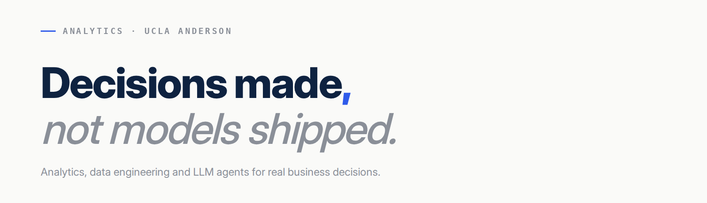

<picture>
  <source media="(prefers-color-scheme: dark)" srcset="./assets/hero-dark.png">
  
</picture>

Hi, I'm Hanson. MS Business Analytics at UCLA Anderson (Dec 2026), with a finance background from UBC. I start with the decision, then check whether the number behind it can be trusted.

### Things I've Built

**[Churn ROI](https://github.com/hansonyjy/churn-roi)**
A customer with a 95% chance of leaving can be the wrong one to save. It scores 10,000 banking customers, spends a fixed retention budget by expected value, and stops when the next offer would lose money. EV targeting beat risk targeting by 20 to 41% in all 9 offer scenarios tested.
[Live demo](https://hansonyjy.github.io/churn-roi/)

**[Starbucks Order Whisperer](https://github.com/hansonyjy/starbucks-order-whisperer)**
1st of 19, UCLA x Starbucks Data Challenge, 88.3% NDCG. Turns orders like "latte under 250 calories" into a ranked menu. Claude reads the request, hard rules filter the menu, and drinks are ranked by how well they fit the limits, with similarity only as a tiebreaker.
[Live demo](https://starbucks-order-whisperer.onrender.com/)

**[AI Stock Alert Agent](https://github.com/hansonyjy/ai-market-desk)** (AI Market Desk)
Watches 500 stocks every 15 minutes and stays quiet until a move has a reason, then emails one plain call with its sources. Before trusting price signals, I backtested 461 of them over five years: only 2 held up, against 0 on random dates, so the system leans on the news instead. About $1 a day.
[`desk demo`](https://github.com/hansonyjy/ai-market-desk#see-it-work-without-keys) replays a recorded live session, no keys needed.

**[NYC Taxi Weather](https://github.com/hansonyjy/end-to-end-nyc-taxi-analytics-pipeline)**
Does rain change how many people take a taxi? The first dashboard said yes. Compared like for like across 7.37M trips, it barely does: JFK +1.0%, Central Park −1.2%, both within noise. The original gap came from charting totals instead of per-day averages, and from a de-duplication bug that dropped 45% of Central Park pickups.
[Live dashboard](https://hansonyjy.github.io/end-to-end-nyc-taxi-analytics-pipeline/)

### What I build

**Analytics.** The right comparison before the chart: experiments, like-for-like controls, expected value.
SQL &middot; Python &middot; pandas &middot; statsmodels &middot; A/B testing &middot; bootstrap intervals &middot; Tableau

**Data engineering.** Pipelines from raw sources to tables an analyst can trust.
PySpark &middot; Snowflake &middot; DuckDB &middot; GCP (Dataproc, GCS) &middot; star schemas &middot; data-quality tests

**Modeling.** Models that feed a decision, calibrated so the probabilities mean something.
scikit-learn &middot; LightGBM &middot; calibration &middot; regression &middot; clustering &middot; Monte Carlo

**LLM systems.** Multi-agent pipelines with structured outputs and deterministic checks around the model.
Claude API &middot; multi-agent orchestration &middot; prompt design &middot; record/replay testing &middot; cost budgets

---

📍 San Jose &middot; [Email](mailto:hansonyang813@gmail.com) &middot; [LinkedIn](https://www.linkedin.com/in/hansony)
