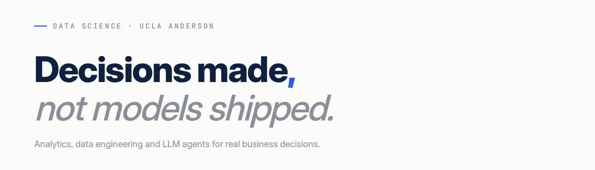

<picture>
  <source media="(prefers-color-scheme: dark)" srcset="./assets/hero-dark.png">
  
</picture>

Hi, I'm Hanson. MS Business Analytics candidate at UCLA Anderson, with a finance background from UBC. I build models and LLM systems, then use them to make a business case, not just a number.

## Selected work

**[AI Market Desk](https://github.com/hansonyjy/ai-market-desk)**
Six AI agents and a rules engine that watch the S&P 500 every 15 minutes and stay quiet until a move has a reason. Then one email: what moved, why (with sources), the key levels, two lenses that may disagree, and one plain call. Code computes every number; models only explain. Every call is graded against the market at 5 and 20 days, and a five-year Rule Lab with a placebo test decides which rules earn a place. Runs for about $1 a day.
[`desk demo`](https://github.com/hansonyjy/ai-market-desk#see-it-work-without-keys) replays a recorded live session offline, no keys needed.

**[Starbucks Order Whisperer](https://github.com/hansonyjy/starbucks-order-whisperer)**
1st of 19, UCLA x Starbucks Data Challenge, 88.3% NDCG. A 3-stage pipeline that turns free-text drink orders into ranked recommendations. Claude extracts the constraints, deterministic rules filter the menu, a hybrid score ranks what is left.
[Live demo](https://starbucks-order-whisperer.onrender.com/)

**[churn-roi](https://github.com/hansonyjy/churn-roi)**
A calibrated churn model inside an expected-value engine. Given a fixed retention budget, it picks which customers are worth saving and the return to expect, not just who is likely to leave.

**[NYC Taxi Analytics Pipeline](https://github.com/hansonyjy/end-to-end-nyc-taxi-analytics-pipeline)**
End-to-end cloud pipeline for NYC taxi demand: PySpark on Dataproc, GCS, Snowflake, Tableau.

Also building **Lumina**, a personal project in Claude Code. Private for now, more soon.

## What I build

**Analytics & ML.** Models that turn customer data into a business decision: churn, lifetime value, recommendation.
Python &middot; scikit-learn &middot; statsmodels &middot; calibration &middot; expected-value modeling

**Data engineering.** Pipelines from raw sources to analytics-ready tables.
SQL &middot; PySpark &middot; Snowflake &middot; GCP (Dataproc, GCS) &middot; Tableau

**LLM systems.** Multi-agent pipelines with structured outputs and deterministic checks around the model.
Claude API &middot; multi-agent orchestration &middot; prompt design &middot; record/replay testing &middot; cost budgets

**Markets.** Signal research and macro work built for portfolio conversations.
Backtesting with placebo tests &middot; technical levels &middot; OECD and FRED data &middot; regime modeling &middot; factor analysis

---

📍 Los Angeles &middot; [Email](mailto:hansonyang813@gmail.com) &middot; [LinkedIn](https://www.linkedin.com/in/hansony)
